```mermaid
flowchart TD
    subgraph INGESTION ["1. Ingestion Layer"]
        OSINT["OSINT Feeds (15+ Sources)<br/>URLhaus, ThreatFox, OTX, CISA KEV"]
        TAXII["TAXII 2.1 Ingestor / Feeds"]
        CRAWLER["Darkweb & Clearweb Spiders<br/>(Tor Circuit Rotation)"]
    end

    subgraph PROCESSING ["2. Processing & Analysis Engine"]
        NLP["SciBERT NLP Engine<br/>Named Entity Recognition (NER)"]
        DECAY["Mathematical Decay Engine<br/>Half-Life Decay & Confidence Composite"]
        CORRELATION["Behavioral Convergence<br/>& Alias Disambiguation"]
        STIX["STIX 2.1 Normalization Engine"]
    end

    subgraph STORAGE ["3. Polyglot Persistence Layer"]
        PG[("PostgreSQL 15<br/>Relational Schemas & Auth")]
        MONGO[("MongoDB 7<br/>STIX Bundles & Raw Telemetry")]
        NEO4J[("Neo4j 5<br/>Threat Actor Knowledge Graph")]
        ES[("Elasticsearch 8<br/>Distributed Full-Text & Analytics")]
        REDIS[("Redis 7<br/>Pub/Sub Event Bus & Caching")]
        QDRANT[("Qdrant Vector DB<br/>RAG Semantic Embeddings")]
    end

    subgraph GATEWAY ["4. Application Gateway & API"]
        FASTAPI["FastAPI 0.115 Core Server<br/>REST Endpoints + WebSockets + GraphQL"]
        GUARDRAILS["AI Security Filter & Guardrails"]
        COPILOT["Onyx Copilot (RAG + Gemini 2.5)"]
    end

    subgraph PRESENTATION ["5. Presentation Layer (Next.js 14 SOC Cockpit)"]
        DASH["Executive Dashboard (KPIs & Risk Matrix)"]
        MAP3D["ThreatMap3D (deck.gl / MapLibre)"]
        GRAPH3D["ThreatGraph (Cytoscape / Orbital 3D)"]
        SIEM["SIEM Rule Generator (SIGMA / YARA / Snort)"]
        STIXVIEW["OASIS STIX 2.1 Bundle Inspector"]
    end

    INGESTION --> PROCESSING
    PROCESSING --> STORAGE
    STORAGE --> GATEWAY
    GATEWAY --> PRESENTATION
```

# 🛡️ Onyx Engine — Autonomous Cyber Threat Intelligence Platform

[](https://github.com/kash-talel/onyx-engine)
[](https://www.python.org/)
[](https://nextjs.org/)
[](https://www.typescriptlang.org/)
[](https://fastapi.tiangolo.com/)
[](https://www.docker.com/)
[](https://oasis-open.github.io/cti-documentation/)
[](LICENSE)

> **Onyx Engine (ONYX CTI v3.0 Genesis)** is an enterprise-grade, sovereign Cyber Threat Intelligence (CTI) ingestion, correlation, and cognitive analysis platform. Engineered for modern Security Operations Centers (SOC), Computer Emergency Response Teams (CERT), and threat hunting units, Onyx aggregates and synthesizes telemetry from 15+ real-time OSINT feeds, applies scientific NLP (SciBERT) for unstructured intelligence extraction, executes automated half-life decay modeling on Indicators of Compromise (IoCs), and provides an immersive 3D/geospatial tactical operating picture.

---

## 📑 Table of Contents

- [Executive Summary](#-executive-summary)
- [System Architecture](#-system-architecture)
- [Core Engineering Pillars](#-core-engineering-pillars)
  - [1. Multi-Source OSINT Harvester & TAXII Ingestion](#1-multi-source-osint-harvester--taxii-ingestion)
  - [2. SciBERT NLP & Named Entity Recognition](#2-scibert-nlp--named-entity-recognition)
  - [3. Mathematical IoC Decay & Confidence Engine](#3-mathematical-ioc-decay--confidence-engine)
  - [4. Polyglot Persistence & Graph Synthesis](#4-polyglot-persistence--graph-synthesis)
  - [5. Cognitive Copilot & RAG Pipeline](#5-cognitive-copilot--rag-pipeline)
  - [6. Tactical 3D Geospatial & Graph Visualizer](#6-tactical-3d-geospatial--graph-visualizer)
- [Technology Stack](#-technology-stack)
- [Directory Structure](#-directory-structure)
- [Prerequisites & Environment Configuration](#-prerequisites--environment-configuration)
- [Installation & Deployment](#-installation--deployment)
  - [Option A: Production Deployment (Docker Compose)](#option-a-production-deployment-docker-compose)
  - [Option B: Local Development (Bare Metal / Standalone)](#option-b-local-development-bare-metal--standalone)
  - [Option C: One-Click Windows Launchers](#option-c-one-click-windows-launchers)
- [Verification & Automated Test Suite](#-verification--automated-test-suite)
- [Standards & Interoperability](#-standards--interoperability)
- [Academic & Engineering Context](#-academic--engineering-context)
- [License](#-license)

---

## 🎯 Executive Summary

Modern cybersecurity operations face an acute signal-to-noise crisis: threat feeds bombard defensive infrastructure with hundreds of thousands of ephemeral, uncurated indicators daily. Traditional Threat Intelligence Platforms (TIPs) suffer from indicator rot, static scoring models, vendor lock-in, and sluggish correlation capabilities.

**Onyx Engine** addresses these systemic challenges through four architectural breakthroughs:
1. **Dynamic Mathematical Decay**: Instead of treating IoCs as binary blacklists, Onyx implements half-life decay algorithms ($S(t) = S_0 \cdot 2^{-t / t_{1/2}}$) categorized by indicator resilience (IPv4, Domains, Hashes, C2 infrastructure, and YARA rules), ensuring active indicators receive priority while obsolete entries degrade automatically.
2. **Autonomous Multi-Source Triangulation**: Live feeds from Abuse.ch, AlienVault OTX, CISA KEV, GDELT, and MITRE ATT&CK are continuously ingested, deduplicated, scored, and cross-correlated.
3. **Deep Linguistic Entity Extraction**: An offline-capable SciBERT transformer pipeline transforms unstructured intelligence documents, pastebin dumps, and dark web transcripts into structured STIX 2.1 bundles with TTP mappings.
4. **Zero-Latency Telemetry & Polyglot Graphs**: High-speed Redis Pub/Sub events stream intelligence directly to a WebGL/deck.gl tactical globe and Cytoscape/3D relational graph within milliseconds.

---

## 🏛️ System Architecture



---

## 🔬 Core Engineering Pillars

### 1. Multi-Source OSINT Harvester & TAXII Ingestion
Onyx Engine integrates with **15+ high-fidelity intelligence feeds** natively:
- **Zero-Key Operational Sources**:
  - **CISA KEV** (Known Exploited Vulnerabilities catalog)
  - **GDELT Project 2.0** (Global geopolitical cyber incident streams)
  - **MITRE ATT&CK Enterprise v14** (Adversary profiles, tactics, techniques)
  - **OpenPhish** (Real-time zero-day phishing telemetry)
  - **Tor Exit Node Directory** (Active anonymization relay lists)
  - **NVD / NIST CVE Stream** (National Vulnerability Database)
  - **CIRCL OSINT** (Computer Incident Response Center Luxembourg feeds)
- **API Key Enhanced Feeds**:
  - **Abuse.ch Ecosystem**: URLhaus, ThreatFox, MalwareBazaar, Feodo Tracker
  - **AlienVault OTX**: Pulses, targeted adversaries, indicator indicators
  - **AbuseIPDB**: High-velocity crowd-sourced IP reputation verification
  - **VirusTotal**: Multi-engine static/dynamic payload inspection

All outbound external requests pass through a consolidated server-side proxy route (`/api/proxy/[source]`) with built-in cache layers, rate limiting, and defensive header sanitization.

### 2. SciBERT NLP & Named Entity Recognition
The NLP subsystem (`onyx-nlp`) leverages specialized transformer models (`allenai/scibert_scivocab_uncased` and spaCy pipelines) to process unstructured threat advisories:
- **Automated Entity Disambiguation**: Extracts threat actors, malware strains, IPv4/v6 addresses, domains, registry keys, and CVE identifiers.
- **TTP Alignment**: Discovers tactic/technique descriptions in prose and maps them to MITRE ATT&CK technique IDs (e.g., Process Hollowing $\to$ `T1055.012`).
- **Defanging / Refanging Logic**: Automatically sanitizes malicious URLs and indicators (`hxxp[://]bad[.]com` $\to$ `http://bad.com`) during lexical parsing.

### 3. Mathematical IoC Decay & Confidence Engine
Indicators in Onyx undergo mathematical degradation modeled as an exponential half-life curve:

$$S(t) = S_0 \cdot 2^{-\frac{\Delta t}{t_{1/2}}}$$

Where:
- $S_0 \in [0, 1]$: Initial confidence score assigned at ingestion.
- $\Delta t$: Elapsed time since last corroboration or observation.
- $t_{1/2}$: Domain-specific half-life period:
  - **Fast-Flux / Cloud IPs**: $t_{1/2} = 24\text{ hours}$
  - **Standard IPv4 / Domains**: $t_{1/2} = 168\text{ hours (7 days)}$
  - **Bulletproof Hosters / C2**: $t_{1/2} = 720\text{ hours (30 days)}$
  - **Cryptographic File Hashes (SHA256)**: $t_{1/2} = \infty$ (Floor $S_{\text{min}} = 0.90$, immutable artifact)

#### Composite Confidence Formulation:
The platform calculates a Bayesian composite confidence score:

$$C_{\text{composite}} = w_{\text{source}} \cdot R_{\text{source}} + w_{\text{corroboration}} \cdot \Phi(N) + w_{\text{temporal}} \cdot S(t) - P_{\text{contested}}$$

Where $\Phi(N) = 1 - e^{-\lambda N}$ models multi-source corroboration asymptotic saturation.

### 4. Polyglot Persistence & Graph Synthesis
Onyx Engine implements a tailored polyglot storage architecture:
- **PostgreSQL 15**: Relational integrity, user roles (RBAC), authentication tokens, and audit logs.
- **MongoDB 7**: High-throughput STIX 2.1 JSON document persistence with compound indices.
- **Neo4j 5**: Native graph database executing Cypher queries for deep graph traversal:
  $$\text{(ThreatActor)} \xrightarrow{\text{USES}} \text{(TTP)} \xrightarrow{\text{TARGETS}} \text{(Sector)} \xleftarrow{\text{OBSERVED\_IN}} \text{(IoC)}$$
- **Elasticsearch 8**: Real-time distributed search across millions of telemetry events.
- **Redis 7**: Sub-millisecond pub/sub message bus, rate limit tracking, and session cache.

### 5. Cognitive Copilot & RAG Pipeline
- **Large Language Model Integration**: Google Gemini 2.5 Flash integrated with temperature modulation and strict cybersecurity prompt engineering.
- **Retrieval-Augmented Generation (RAG)**: Connects to a Qdrant Vector Store indexing threat profiles and historical incident reports with dense vector embeddings.
- **Security Guardrails**: Input/output lexical sanitizers, prompt injection mitigation, and automated SIEM rule verification.

### 6. Tactical 3D Geospatial & Graph Visualizer
- **ThreatMap3D**: Built on **deck.gl** and **MapLibre GL**, rendering global 3D Bezier arcs connecting adversary infrastructure (origin ASN/country) to targeted SOC assets with real-time particle animation.
- **ThreatGraph Orbital Matrix**: Built on **Cytoscape.js** with `cose-bilkent` and `dagre` physics layout algorithms, visualizing multi-tiered relationships between nation-state actors, malware families, CVEs, and affected industries.

---

## 💻 Technology Stack

| Domain | Technology / Library | Version | Purpose |
|---|---|---|---|
| **Frontend Framework** | [Next.js](https://nextjs.org/) (App Router) | `14.2` | Production React SSR & edge API routing |
| **Frontend Language** | [TypeScript](https://www.typescriptlang.org/) | `5.0+` | Strict-mode type safety throughout |
| **Styling** | [Tailwind CSS](https://tailwindcss.com/) | `3.4` | Cyberpunk / SOC dark-mode theme system |
| **Geospatial 3D** | [deck.gl](https://deck.gl/) + [MapLibre GL](https://maplibre.org/) | `9.2 / 5.2` | WebGL hardware-accelerated globe & arcs |
| **Network Graphs** | [Cytoscape.js](https://js.cytoscape.org/) | `3.33` | Directed threat topologies & graph physics |
| **State Management**| [Zustand](https://github.com/pmndrs/zustand) | `5.0` | High-frequency telemetry state stores |
| **Backend API** | [FastAPI](https://fastapi.tiangolo.com/) | `0.115` | Async ASGI REST, WebSocket & GraphQL API |
| **Backend Language** | [Python](https://www.python.org/) | `3.11 / 3.12` | Core computing runtime |
| **ASGI Server** | [Uvicorn](https://www.uvicorn.org/) | `0.29+` | High-concurrency worker event loop |
| **NLP & AI Engine** | [SciBERT](https://github.com/allenai/scibert) + [spaCy](https://spacy.io/) | Transformers | Deep textual entity extraction & TTP tagging |
| **GenAI & Vector** | [Gemini 2.5 Flash](https://ai.google.dev/) + [Qdrant](https://qdrant.tech/) | Latest | Autonomous Copilot & RAG vector search |
| **Relational DB** | [PostgreSQL](https://www.postgresql.org/) | `15-alpine` | Users, authentication, persistent configurations |
| **Document Store** | [MongoDB](https://www.mongodb.com/) | `7.0` | STIX 2.1 entities, dynamic reports, raw telemetry |
| **Graph Database** | [Neo4j](https://neo4j.com/) | `5-community` | Relational threat actor graph intelligence |
| **Search Engine** | [Elasticsearch](https://www.elastic.co/) | `8.13` | Distributed multi-field IoC search & aggregation |
| **Event Broker** | [Redis](https://redis.io/) | `7-alpine` | WebSocket hub, pub/sub streams, distributed cache |
| **Task Queue** | [Celery](https://docs.celeryq.dev/) | `5.3+` | Asynchronous OSINT ingestors & decay loops |
| **Anonymization** | [Tor](https://www.torproject.org/) + Privoxy | Latest | Darkweb crawler proxy with circuit rotation |

---

## 📁 Directory Structure

```text
onyx-engine/
├── .env.example                     # Environment configuration template
├── .gitignore                       # Production gitignore (security hardened)
├── docker-compose.yml               # Multi-service container orchestration
├── Dockerfile.backend               # Multi-stage production Python ASGI build
├── Makefile                         # Unified operations and build targets
├── requirements.txt                 # Flat backend dependency specification
├── start_ONYX_demo.bat              # Zero-config Windows demo launcher
├── start_ONYX_full.bat              # Full-stack Windows orchestration launcher
│
├── onyx-api/                        # FastAPI REST, WebSocket & GraphQL Engine
│   ├── onyx_api/
│   │   ├── auth/                    # JWT token management & RBAC security
│   │   ├── routers/                 # Modular API endpoints (iocs, actors, taxii, etc.)
│   │   ├── services/                # Business logic (Gemini, GeoIP, RAG, OSINT)
│   │   ├── utils/                   # Guardrails and defensive filters
│   │   └── workers/                 # Background workers (Decay, OSINT poller, RSS)
│   ├── migrations/                  # Database migration scripts
│   ├── data/                        # Offline MaxMind GeoLite2 City database
│   ├── tests/                       # API endpoint verification test suite
│   └── pyproject.toml               # Python package configuration
│
├── onyx-core/                       # Shared Domain Core & Mathematical Engines
│   ├── onyx_core/
│   │   ├── models/                  # OASIS STIX 2.1, Threat Actor, IoC schemas
│   │   └── services/                # Database clients (Mongo, ES, PG, Neo4j, Redis)
│   │       ├── decay_engine.py      # Half-life exponential decay implementation
│   │       └── confidence_composite.py # Bayesian multi-factor confidence scoring
│   ├── tests/
│   │   ├── unit/                    # 81 property-based tests (Hypothesis + Pytest)
│   │   └── integration/             # Database-backed integration scenarios
│   └── pyproject.toml               # Core package specifications
│
├── onyx-nlp/                        # Scientific NLP & Machine Learning Engine
│   ├── onyx_nlp/
│   │   ├── extractors/              # SciBERT IoC & TTP extraction pipelines
│   │   └── processors/              # Document preprocessing & defanging
│   └── pyproject.toml
│
├── onyx-crawlers/                   # Intelligence Harvesters & Darkweb Spiders
│   ├── onyx_crawlers/
│   │   ├── clearweb/                # GitHub and Pastebin secret & leak monitors
│   │   └── darkweb/                 # Tor-proxied .onion crawlers & ransomware blogs
│   └── pyproject.toml
│
├── onyx-dashboard/                  # Next.js 14 SOC Cockpit (App Router)
│   ├── src/
│   │   ├── app/                     # Next.js routes & server-side API proxies
│   │   ├── components/              # 35+ React SOC operational components
│   │   │   ├── ThreatMap3D.tsx      # deck.gl WebGL tactical globe
│   │   │   ├── ThreatGraph.tsx      # Cytoscape.js threat network graph
│   │   │   ├── ExecutiveDashboard.tsx # SOC KPI matrix & alert feeds
│   │   │   ├── OnyxCopilot.tsx      # Interactive AI tactical advisor
│   │   │   └── SIEMRuleConverter.tsx # SIGMA / YARA / Snort automated exporter
│   │   ├── lib/                     # 15+ OSINT client connectors & state stores
│   │   └── styles/                  # Tailwind CSS variables & tokens
│   ├── Dockerfile.frontend          # Multi-stage optimized Node.js Alpine build
│   └── package.json                 # Dashboard frontend dependencies
│
├── infra/                           # Infrastructure configurations
│   ├── elasticsearch/               # Index lifecycle & mapping settings
│   ├── mongodb/                     # Init scripts & collection indices
│   └── tor/                         # Tor daemon, Privoxy & circuit rotator
│
└── scripts/                         # Operational & stress-testing utilities
    ├── exhibition_injector.py       # Realistic APT29 / LockBit STIX injector
    └── verify_flow.py               # Zero-latency GeoIP Redis validation script
```

---

## ⚙️ Prerequisites & Environment Configuration

### System Prerequisites
- **Node.js**: $\ge 18.18$ (Node 20 LTS recommended)
- **Python**: $\ge 3.11$ (Python 3.12 verified)
- **Docker & Docker Compose**: Docker Desktop 4.25+ or Docker Engine with `compose` plugin
- **Memory**: Minimum 8 GB RAM (16 GB recommended for full Docker polyglot stack)

### Environment Configuration
Copy the configuration template to `.env`:
```bash
cp .env.example .env
```

Key environment parameters in `.env`:
```ini
# General Settings
ONYX_ENV=development
ONYX_DEBUG=true
ONYX_SECRET_KEY=<64-char-random-hex>

# API & Networking
ONYX_API_HOST=0.0.0.0
ONYX_API_PORT=8000
ONYX_API_CORS_ORIGINS=["http://localhost:3000"]

# Database Credentials
POSTGRES_USER=onyx_admin
POSTGRES_PASSWORD=onyx_pg_secret_2026
REDIS_PASSWORD=onyx_redis_secret_2026
NEO4J_PASSWORD=onyx_graph_secret_2026
MONGODB_PASSWORD=onyx_mongo_secret_2026
ELASTICSEARCH_PASSWORD=onyx_elastic_secret_2026

# AI & RAG Subsystem (Optional - Platform provides graceful mock fallbacks)
GEMINI_API_KEY=<your-google-ai-studio-api-key>
GEMINI_MODEL=gemini-2.5-flash
QDRANT_URL=
QDRANT_API_KEY=

# OSINT Feed Keys (Optional - Free-tier feeds operate out of the box)
URLHAUS_API_KEY=
THREATFOX_API_KEY=
OTX_API_KEY=
OSINT_ABUSEIPDB_API_KEY=
OSINT_VIRUSTOTAL_API_KEY=
```

---

## 🚀 Installation & Deployment

### Option A: Production Deployment (Docker Compose)
To launch the complete distributed stack with all databases, backend, and dashboard containerized:

```bash
# 1. Clone the repository
git clone https://github.com/kash-talel/onyx-engine.git
cd onyx-engine

# 2. Build and launch all services in detached mode
docker compose up -d --build

# 3. Inspect running services
docker compose ps

# 4. Tail aggregated logs
docker compose logs -f
```

The services will be available at:
- **SOC Cockpit (Dashboard)**: `http://localhost:3000`
- **Backend API & Swagger Docs**: `http://localhost:8000/docs`
- **Neo4j Browser**: `http://localhost:7474`
- **Elasticsearch Cluster**: `http://localhost:9200`

---

### Option B: Local Development (Bare Metal / Standalone)
Onyx Engine features an autonomous **Standalone Fallback Mode**: if external database containers are not running, the backend seamlessly initializes in-memory caches, offline GeoLite2 localization, and live OSINT fallback feeds.

```bash
# Terminal 1: Backend API
cd onyx-api
pip install -r ../requirements.txt
pip install -e ../onyx-core
pip install -e .
python -m uvicorn onyx_api.main:app --host 0.0.0.0 --port 8000 --reload

# Terminal 2: Dashboard Frontend
cd onyx-dashboard
npm install
npm run dev
```

Navigate to `http://localhost:3000` to interact with the platform.

---

### Option C: One-Click Windows Launchers
For Windows workstations, automated batch scripts manage path resolution, process health, and multi-window startup:
- **`start_ONYX_full.bat`**: Comprehensive launcher that kills orphan processes, builds paths, starts backend and frontend, and launches the browser.
- **`start_ONYX_demo.bat`**: Quick launcher that boots backend in standalone mode and fires the SciBERT stress test.

---

## 🧪 Verification & Automated Test Suite

Onyx Engine includes an extensive, enterprise-grade test suite covering mathematical decay invariants, Bayesian confidence weights, source reliability matrix properties, and API contract validity.

To run the full unit test suite:
```bash
# Using Makefile
make test

# Or directly with pytest
python -m pytest onyx-core/tests/unit -v
python -m pytest onyx-api/tests -v
```

### Test Results Breakdown:
- **`test_decay_engine.py`**: Validates exponential half-life properties, half-life exactness at $t = t_{1/2}$, monotonicity, boundary adherence in $[0, 1]$, and state classification (`valid`, `degrading`, `stale`, `obsolete`).
- **`test_confidence_composite.py`**: Verifies Bayesian source reliability matrices, contextual relevance sector bounds, contestation penalties, and analyst override idempotence.
- **`test_api_health.py`**: Validates HTTP 200 liveness probes and telemetry payload schema integrity.

**Result**: `82 passed, 0 failures` (100% pass rate).

---

## 🌐 Standards & Interoperability

| Standard | Specification | Implementation in Onyx |
|---|---|---|
| **STIX 2.1** | OASIS Standard | Full serialization & parsing (`ThreatActor`, `Indicator`, `Malware`, `AttackPattern`, `Relationship`, `Report`) |
| **TAXII 2.1** | OASIS Standard | Endpoints for discovery (`/taxii2/`), API roots, collections, and envelope ingest |
| **MITRE ATT&CK** | Enterprise Matrix v14 | Automatic technique mapping and kill-chain phase alignment |
| **TLP 2.0** | FIRST Standards | Traffic Light Protocol markings (`WHITE`, `GREEN`, `AMBER`, `AMBER+STRICT`, `RED`) |
| **SIGMA** | Generic SIEM Rule Format | Automated conversion of detected IoCs to production SIGMA rules |
| **YARA** | Pattern Matching | Automated compilation of file and byte sequence signatures |
| **Snort / Suricata**| Network IDS Rules | Automatic IDS rule generation from IPv4 and domain indicators |

---

## 🎓 Academic & Engineering Context

This project represents the culmination of advanced engineering and academic research in **Cyber Threat Intelligence, Machine Learning in Defense Systems, and High-Performance Distributed Systems**.

### Key Research Contributions:
1. **Empirical Indicator Life-Cycle Modeling**: Formulation and implementation of algorithmic decay for threat indicators to eliminate defensive telemetry saturation.
2. **Cognitive Triangulation**: Fusion of deterministic threat feeds with transformer-based NLP and Large Language Model reasoning under strict safety guardrails.
3. **Hardware-Accelerated Situational Awareness**: Bringing military-grade 3D geospatial intelligence visualization to standard browser environments via WebGL shaders and deck.gl.

### Author & Engineering Lead:
- **Kash Talel** ([@kash-talel](https://github.com/kash-talel))  
  *Cybersecurity Architect & Distributed Systems Engineer*

---

## 📜 License

This project is licensed under the **MIT License** — see the [LICENSE](LICENSE) file for complete details.
