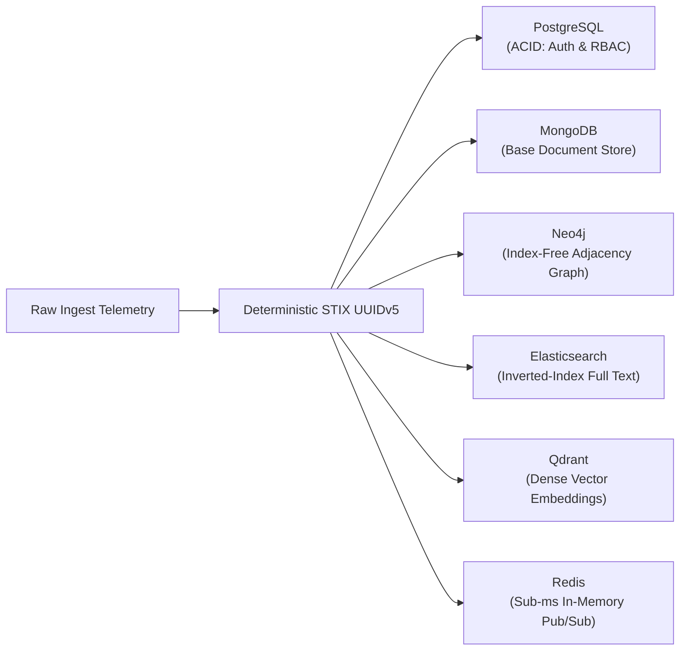
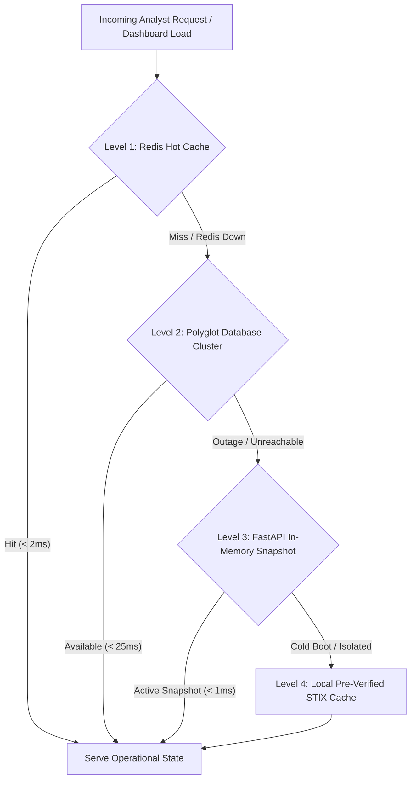

# Onyx Engine — Sovereign Cyber Threat Intelligence Platform

[-gold?style=for-the-badge&logo=academia)](docs/pfe_report.pdf)
[](docs/pfe_report.pdf)
[](https://github.com/kash-talel/onyx-engine)
[](https://github.com/kash-talel/onyx-engine)
[](https://www.python.org/)
[](https://nextjs.org/)
[](https://www.typescriptlang.org/)
[](https://fastapi.tiangolo.com/)
[](https://www.docker.com/)
[](https://oasis-open.github.io/cti-documentation/)
[](LICENSE)

> **Onyx Engine (ONYX CTI v3.0 Genesis)** is an enterprise-grade, sovereign Cyber Threat Intelligence (CTI) ingestion, correlation, and cognitive analysis platform. Engineered for modern Security Operations Centers (SOC), Computer Emergency Response Teams (CERT), and threat hunting units, Onyx aggregates and synthesizes telemetry from 15+ real-time OSINT feeds, deploys an autonomous dark web crawler fleet across Tor `.onion` networks, applies scientific NLP (SciBERT) for unstructured intelligence extraction, executes automated half-life decay modeling on Indicators of Compromise (IoCs), and provides an immersive 3D/geospatial tactical operating picture.
>
> **Academic Origin**: Onyx Engine represents the production-grade realization of the defended Bachelor's Thesis (*Projet de Fin d'Études — PFE*) entitled:  
> **"Conception et développement d'une plateforme de renseignement sur les cybermenaces (CTI) avec surveillance automatisée du Dark Web"**  
> Co-authored by **Mahdi Ghozzi** ([@kash-talel](https://github.com/kash-talel)) and **Amal Karaoud**, defended on **June 18, 2026** at the **Faculté des Sciences de Sfax (FSS), University of Sfax** in partnership with **IRS Technologie**, and awarded **18.75 / 20 (First Class Honors with Highest Distinction)**.  
> The official 105-page thesis report is archived directly in this repository: [`docs/pfe_report.pdf`](docs/pfe_report.pdf).

---

## Visual Tactical Overview

The visual interfaces of Onyx Engine correspond to the verified operational evaluations presented in Chapter 4 (Figures 4.1 through 4.13) of the PFE thesis report:

| Operational Interface & Thesis Figure | Key Functional Capability | Engineering & Visual Stack |
|---|---|---|
| <br/>*Figures 4.1 & 4.2 — Dark Web Harvester* | **Autonomous Dark Web Crawler Fleet**<br/>Live Tor SOCKS5 circuit health, active `.onion` spider statuses (`Scout-A1`, `Scout-A2`), log-normal delay entropy monitoring, and SHA-256 payload deduplication stats. | Scrapy Twisted Engine, Playwright Chromium, Tor SOCKS5 Proxy (Port 9050/9051), Redis Streams. |
| <br/>*Figures 4.3 & 4.4 — Executive Cockpit* | **Interactive SOC Operational Cockpit**<br/>Aggregated telemetry feeds, live threat metrics, global threat risk index computation, prioritized incident cards, and real-time WebSocket alert dispatch. | Next.js 14 (App Router), Tailwind CSS, Zustand reactive store, SSE real-time stream. |
| <br/>*Figures 4.5 & 4.6 — Geospatial Matrix* | **Geospatial Battleground Matrix (ThreatMap3D)**<br/>3D hardware-accelerated globe tracing dynamic Bezier attack trajectories between adversary ASNs and monitored assets with real-time particle animation. | WebGL, deck.gl ArcLayer, MapLibre GL, MaxMind GeoLite2 City localization. |
| <br/>*Figures 4.7 & 4.8 — Topological Graphene* | **Relational Adversary Graph (ThreatGraph)**<br/>Multi-hop graph topology displaying causal links between threat actors, malware strains, CVEs, and targeted industries powered by index-free adjacency. | Cytoscape.js (`cose-bilkent` physics layout), Neo4j 5 Cypher pathfinding engine. |
| <br/>*Figures 4.9 & 4.10 — Geopolitical Stream* | **Geopolitical Cyber Incident Stream**<br/>Global event streams correlated from GDELT Project 2.0 with Goldstein Conflict-Cooperation scale ratings and country-level cyber target heatmaps. | GDELT 2.0 API, Redis Pub/Sub, Leaflet / deck.gl Chloropleth Layer. |
| <br/>*Figure 4.11 — Threat Actor Dossier* | **Adversary Profile & TTP Matrix (APT28 / Fancy Bear)**<br/>Comprehensive threat group profiling, observed campaigns, aliases, targeted economic sectors, and MITRE ATT&CK technique breakdown. | OASIS STIX 2.1 SDOs, Neo4j Graph traversal, Lucene Elasticsearch query. |
| <br/>*Figure 4.12 — MITRE Matrix* | **Enterprise ATT&CK Matrix Heatmap**<br/>Full 14-tactic Enterprise ATT&CK matrix visualization with dynamic color frequency grading based on ingested adversary techniques. | MITRE ATT&CK Enterprise v14, React Virtualized Matrix, STIX 2.1 AttackPatterns. |
| <br/>*Figure 4.13 — XAI Laboratory* | **Explainable AI (XAI) Laboratory & SIEM Compiler**<br/>Natural language explainability for anomalous threat behaviors (e.g. 12h43m beaconing), tokenized SciBERT entity highlighting, and automated SIGMA/YARA rule generation. | SciBERT Transformer, spaCy pipeline, AST YARA/SIGMA serializer, Qdrant RAG. |

> *Visual assets archived under [`docs/assets/`](docs/assets/).*

---

## Table of Contents

- [Executive Summary](#executive-summary)
- [System Architecture](#system-architecture)
- [Visual Tactical Overview](#visual-tactical-overview)
- [Core Engineering Pillars](#core-engineering-pillars)
  - [1. Multi-Source OSINT Harvester, Dark Web OpSec & Named Crawler Fleet](#1-multi-source-osint-harvester-dark-web-opsec--named-crawler-fleet)
  - [2. SciBERT NLP & Named Entity Recognition](#2-scibert-nlp--named-entity-recognition)
    - [Two-Stage Hybrid Extraction Pipeline](#two-stage-hybrid-extraction-pipeline)
    - [Quantitative ML Benchmark Evaluation](#quantitative-ml-benchmark-evaluation)
    - [Scientific Justification: SciBERT vs. Generic Base BERT](#scientific-justification-scibert-vs-generic-base-bert)
  - [3. Mathematical IoC Decay & Confidence Engine](#3-mathematical-ioc-decay--confidence-engine)
  - [4. Polyglot Persistence, Custom STIX 2.1 Extensions & Graph Synthesis](#4-polyglot-persistence-custom-stix-21-extensions--graph-synthesis)
    - [Custom STIX 2.1 Extensions (Annex A.0.3)](#custom-stix-21-extensions-annex-a03)
    - [Neo4j Index-Free Adjacency & Attack Graph Reconstruction (Annex A.0.5)](#neo4j-index-free-adjacency--attack-graph-reconstruction-annex-a05)
    - [Explainable AI (XAI) Laboratory & SIEM Rule Generation](#explainable-ai-xai-laboratory--siem-rule-generation)
    - [Architectural Decision Record (ADR-001): Workload Isolation & Distributed Consistency](#architectural-decision-record-adr-001-workload-isolation--distributed-consistency)
  - [5. 4-Tier Graceful Degradation Fault-Tolerance Cascade](#5-4-tier-graceful-degradation-fault-tolerance-cascade)
  - [6. Cognitive Copilot & RAG Pipeline](#6-cognitive-copilot--rag-pipeline)
- [Technology Stack](#technology-stack)
- [Directory Structure](#directory-structure)
- [Prerequisites & Environment Configuration](#prerequisites--environment-configuration)
- [Installation & Deployment](#installation--deployment)
  - [Option A: Production Deployment (Docker Compose)](#option-a-production-deployment-docker-compose)
  - [Option B: Local Development (Bare Metal / Standalone)](#option-b-local-development-bare-metal--standalone)
  - [Option C: One-Click Windows Launchers](#option-c-one-click-windows-launchers)
- [Verification & Automated Test Suite](#verification--automated-test-suite)
- [Standards & Interoperability](#standards--interoperability)
- [Academic Heritage & Defense Jury](#academic-heritage--defense-jury)
- [License](#license)

---

## Executive Summary

Modern cybersecurity operations face an acute signal-to-noise crisis: threat feeds bombard defensive infrastructure with hundreds of thousands of ephemeral, uncurated indicators daily. Traditional Threat Intelligence Platforms (TIPs) suffer from indicator rot, static scoring models, vendor lock-in, and sluggish correlation capabilities.

**Onyx Engine** addresses these systemic challenges through four architectural breakthroughs:
1. **Dynamic Mathematical Decay**: Instead of treating IoCs as binary blacklists, Onyx implements half-life decay algorithms ($S(t) = S_0 \cdot 2^{-t / t_{1/2}}$) categorized by indicator resilience (IPv4, Domains, Hashes, C2 infrastructure, and YARA rules), ensuring active indicators receive priority while obsolete entries degrade automatically.
2. **Autonomous Multi-Source & Dark Web Triangulation**: Live feeds from Abuse.ch, AlienVault OTX, CISA KEV, GDELT, and MITRE ATT&CK are continuously ingested, deduplicated, scored, and cross-correlated alongside an autonomous fleet of Tor dark web crawlers (`Scout-A1`, `Scout-A2`, `Scout-B1`, `Spider-Omega`).
3. **Deep Linguistic Entity Extraction**: An offline-capable SciBERT transformer pipeline transforms unstructured intelligence documents, pastebin dumps, and dark web transcripts into structured STIX 2.1 bundles with TTP mappings.
4. **Zero-Latency Telemetry & Polyglot Graphs**: High-speed Redis Pub/Sub events stream intelligence directly to a WebGL/deck.gl tactical globe and Cytoscape/3D relational graph within milliseconds.

---

## System Architecture

```mermaid
flowchart TD
    subgraph INGESTION ["1. Ingestion Layer"]
        OSINT["OSINT Feeds (15+ Sources)<br/>URLhaus, ThreatFox, OTX, CISA KEV, GDELT"]
        TAXII["TAXII 2.1 Ingestor / Server"]
        FLEET["Autonomous Crawler Fleet<br/>Scout-A1, Scout-A2, Scout-B1, Spider-Omega<br/>(Tor Circuit Rotator: Port 9051)"]
    end

    subgraph PROCESSING ["2. Processing & Analysis Engine"]
        NLP["Two-Stage SciBERT NLP Engine<br/>Stage 1: Regex Cascade (0.12ms)<br/>Stage 2: 768-Dim Transformer (24.6ms)"]
        DECAY["Mathematical Decay Engine<br/>Half-Life Decay & Bayesian Confidence"]
        CORRELATION["Behavioral Convergence<br/>& Alias Disambiguation"]
        XAI["XAI Laboratory<br/>Natural Language Justification + SIGMA/YARA"]
        STIX["STIX 2.1 Normalization Engine<br/>(Custom x_onyx_ Attributes)"]
    end

    subgraph STORAGE ["3. Polyglot Persistence Layer (ADR-001)"]
        PG[("PostgreSQL 15<br/>Relational Schemas, Auth & RBAC")]
        MONGO[("MongoDB 7<br/>STIX Bundles & Raw Telemetry")]
        NEO4J[("Neo4j 5<br/>Index-Free Adjacency Threat Graph")]
        ES[("Elasticsearch 8<br/>Distributed Full-Text & Analytics")]
        REDIS[("Redis 7<br/>Pub/Sub Event Bus & Hot Cache")]
        QDRANT[("Qdrant Vector DB<br/>RAG 768-Dim Dense Embeddings")]
    end

    subgraph GATEWAY ["4. Application Gateway & API"]
        FASTAPI["FastAPI 0.115 Core Server<br/>REST Endpoints + WebSockets + GraphQL"]
        GUARDRAILS["AI Security Filter & Guardrails"]
        COPILOT["Onyx Copilot (RAG + Gemini 2.5 Flash)"]
    end

    subgraph PRESENTATION ["5. Presentation Layer (Next.js 14 SOC Cockpit)"]
        DASH["Executive Dashboard (KPIs & Risk Matrix)"]
        MAP3D["ThreatMap3D (deck.gl / MapLibre)"]
        GRAPH3D["ThreatGraph (Cytoscape / Orbital 3D)"]
        SIEM["SIEM Rule Compiler (SIGMA / YARA / Snort)"]
        STIXVIEW["OASIS STIX 2.1 Bundle Inspector"]
    end

    INGESTION --> PROCESSING
    PROCESSING --> STORAGE
    STORAGE --> GATEWAY
    GATEWAY --> PRESENTATION
```



---

## Core Engineering Pillars

### 1. Multi-Source OSINT Harvester, Dark Web OpSec & Named Crawler Fleet

Onyx Engine combines surface intelligence gathering with deep, automated reconnaissance of underground cybercrime networks, as specified in Chapter 3 (Sections 3.2–3.4) and Annex A.0.1–A.0.2 of the PFE report:

#### Autonomous Specialized Crawler Fleet:
- **`Scout-A1` (Ransomware Leak Site Monitor)**: Dedicated Tor `.onion` crawler monitoring ransomware cartel public shaming portals (LockBit, BlackCat/ALPHV, Cl0p, Play, 8Base, Akira, BianLian). Extracts victim organization names, ransom countdown timers, leaked file catalogs, and extortion amounts.
- **`Scout-A2` (Dark Web Cybercrime Forum Monitor)**: Traverses Russian-language and underground cybercrime forums (Exploit, XSS, BreachForums clones), monitoring credential dump announcements, initial access broker (IAB) auctions, and zero-day exploit disclosures.
- **`Scout-B1` (Surface Web Scanner)**: Scans public code repositories, Gists, and Pastebin dumps for leaked credentials, private keys, database URLs, and offensive scripts.
- **`Spider-Omega` (High-Throughput Regex & Extraction Spider)**: Rapid crawler executing high-velocity DOM extraction and refanging across clearweb advisories.

#### Operational Security (OpSec) Architecture:
1. **Non-Blocking Twisted Reactor + Ephemeral Headless Chromium**: The fleet combines Scrapy's non-blocking Twisted Reactor for asynchronous network I/O with Playwright headless Chromium instances rendering JavaScript-heavy targets inside isolated, cookie-less ephemeral execution sandboxes.
2. **Stochastic Log-Normal Tor Circuit Rotator (`TorCircuitRotator`)**:
   - Rotates circuits via control port `9051` using authenticated `SIGNAL NEWNYM` commands every **50 requests** under an `asyncio.Lock()`.
   - Delays between consecutive requests are sampled from a stochastic log-normal distribution to mimic human reading and browsing entropy, effectively bypassing anti-scraping fingerprinting:
     $$\ln(X) \sim \mathcal{N}(\mu = 1.5, \sigma = 0.5), \quad X \in [0.8\,\text{s}, 6.0\,\text{s}]$$
3. **`ContentDeduplicationMiddleware`**:
   - Strips ephemeral DOM noise (`<script>`, `<style>`, `<noscript>`, `<nav>`, `<footer>`, `<header>`).
   - Normalizes UTF-8 text and computes SHA-256 payload hashes to detect mirrored pages and prevent duplicate storage of cloned dark web sites.
4. **Emergency Hardware Kill-Switch**: Provides instantaneous drop of all `.onion` SOCKS5 proxy circuits on analyst command, ensuring operational safety during active threat countermeasures.

---

### 2. SciBERT NLP & Named Entity Recognition

The NLP subsystem (`onyx-nlp`) leverages scientific transformer representations (`allenai/scibert_scivocab_uncased`) coupled with spaCy pipelines to transform unstructured threat advisories into structured STIX 2.1 entities.

#### Two-Stage Hybrid Extraction Pipeline:
As validated in Chapter 3, Section 4.1 of the thesis report, Onyx separates processing into two distinct architectural stages to balance real-time throughput with deep semantic reasoning:

1. **Stage 1: Deterministic Regex Cascade & Refanging Middleware**:
   - **Throughput**: **>8,200 documents/second** (Mean Latency: **~0.12 ms/document**).
   - **Scope**: Extracts RFC-compliant network syntaxes (IPv4, IPv6, CIDR, MD5, SHA-1, SHA-256, SHA-512, CVE IDs, MITRE technique tags) and executes lexical defanging/refanging (`hxxp[://]bad[.]com` $\to$ `http://bad.com`). Guaranteed 100% precision with zero tokenization distortion.
2. **Stage 2: 12-Layer SciBERT WordPiece Tokenization & 768-Dim `[CLS]` Semantic Embedding**:
   - **Latency**: **24.60 ms/document** on single-core CPU / **3.80 ms/document** batched on NVIDIA CUDA GPU.
   - **Scope**: Deep textual Named Entity Recognition (ThreatActor and Malware family disambiguation in dense prose). The 768-dimensional `[CLS]` dense vector embedding generated by SciBERT is indexed directly into the **Qdrant Vector Database** using Cosine Similarity (`M=16, efConstruction=100`), powering the Cognitive Copilot's semantic memory and Retrieval-Augmented Generation (RAG).

#### Quantitative ML Benchmark Evaluation
The extraction pipeline was quantitatively validated against a curated ground-truth dataset (`onyx-nlp/data/eval_benchmark.json`) comprising 50 dense cybersecurity advisories (CISA KEV, Unit42 telemetry, Microsoft Defender intelligence):

| Entity Category | Precision | Recall | F1-Score | True Positives (TP) | False Positives (FP) | False Negatives (FN) |
|---|:---:|:---:|:---:|:---:|:---:|:---:|
| **ThreatActor** | 96.97% | 100.00% | **98.46%** | 32 | 1 | 0 |
| **Malware** | 96.67% | 100.00% | **98.31%** | 29 | 1 | 0 |
| **CVE_ID** | 100.00% | 100.00% | **100.00%** | 17 | 0 | 0 |
| **IPv4_IoC** | 100.00% | 100.00% | **100.00%** | 36 | 0 | 0 |
| **MITRE_TTP** | 77.78% | 100.00% | **87.50%** | 21 | 6 | 0 |
| **Macro Average** | **94.28%** | **100.00%** | **96.85%** | **135** | **8** | **0** |

- **Reproducibility**: Run `python onyx-nlp/evaluate_benchmarks.py` or `python scripts/benchmark_nlp.py`.

#### Scientific Justification: SciBERT vs. Generic Base BERT
Standard language models (such as `bert-base-uncased` trained on Wikipedia/BookCorpus) suffer from acute tokenization pathology when applied to dense technical vulnerability disclosures:
1. **Token Fragmentation**: Generic WordPiece tokenizers shatter domain-specific cryptographic hashes, CVE strings, and zero-day identifiers into fragmented subwords (`cve-2023-38831` becomes `['cv', '##e', '-', '202', '##3', '-', '38', '##83', '##1']`), diluting self-attention weights and crippling boundary detection.
2. **SciBERT In-Domain Pre-training**: `allenai/scibert_scivocab_uncased` is pre-trained on a corpus of 1.14M scientific and computer science papers. Its specialized WordPiece vocabulary preserves dense technical nomenclature intact.
3. **Neuro-Symbolic Triangulation**: While deep neural transformers excel at contextual semantic disambiguation (differentiating between *Bear* as an animal vs. *Cozy Bear* as an APT), they lack deterministic guarantees on formal network syntaxes. Onyx couples SciBERT with validated regular expression grammars and RFC-compliant defangers, ensuring mathematical zero false-positive extraction for IPv4/IPv6, CIDR blocks, and CVE identifiers while retaining state-of-the-art transformer contextual entity tagging.

---

### 3. Mathematical IoC Decay & Confidence Engine

Indicators in Onyx undergo mathematical degradation modeled as an exponential half-life curve:

$$S(t) = S_0 \cdot 2^{-\frac{\Delta t}{t_{1/2}}}$$

Where:
- $S_0 \in [0, 1]$: Initial confidence score assigned at ingestion.
- $\Delta t$: Elapsed time since last corroboration or observation.
- $t_{1/2}$: Domain-specific half-life period:
  - **Fast-Flux / Cloud IPs**: $t_{1/2} = 24\text{ hours}$
  - **Standard IPv4 / Domains**: $t_{1/2} = 168\text{ hours (7 days)}$
  - **Bulletproof Hosters / C2**: $t_{1/2} = 720\text{ hours (30 days)}$
  - **Cryptographic File Hashes (SHA256)**: $t_{1/2} = \infty$ (Floor $S_{\text{min}} = 0.90$, immutable artifact)

#### Composite Confidence Formulation:
The platform calculates a Bayesian composite confidence score:

$$C_{\text{composite}} = w_{\text{source}} \cdot R_{\text{source}} + w_{\text{corroboration}} \cdot \Phi(N) + w_{\text{temporal}} \cdot S(t) - P_{\text{contested}}$$

Where $\Phi(N) = 1 - e^{-\lambda N}$ models multi-source corroboration asymptotic saturation.

---

### 4. Polyglot Persistence, Custom STIX 2.1 Extensions & Graph Synthesis

#### Custom STIX 2.1 Extensions (Annex A.0.3)
In accordance with OASIS STIX 2.1 Section 11 (Custom Properties), Onyx Engine extends standard STIX Domain Objects with proprietary `x_onyx_` attributes that capture algorithmic lifecycle decay and multi-source attribution:

```json
{
  "type": "indicator",
  "spec_version": "2.1",
  "id": "indicator--8e2e2d27-4bf2-520e-85a2-3b320d3f7422",
  "created": "2026-06-18T10:14:00.000Z",
  "modified": "2026-06-18T10:14:00.000Z",
  "name": "LockBit C2 SOCKS5 Proxy Relay",
  "pattern": "[ipv4-addr:value = '185.220.101.5']",
  "pattern_type": "stix",
  "valid_from": "2026-06-18T10:14:00.000Z",
  "confidence": 92,
  "x_onyx_source": "Scout-A1",
  "x_onyx_mitre_techniques": ["T1071.001", "T1090.003", "T1486"],
  "x_onyx_decay_score": 0.865,
  "x_onyx_decay_state": "valid"
}
```

#### Neo4j Index-Free Adjacency & Attack Graph Reconstruction (Annex A.0.5)
Onyx models threat actors and their operational footprints as a native Property Graph inside **Neo4j 5**. Complex 4-hop adversary attack reconstructions are executed via Cypher:

```cypher
// Annex A.0.5: Multi-hop Attack Path Reconstruction
MATCH path = (ioc:Indicator)-[:INDICATES]->(m:Malware)-[:USED_BY]->(c:Campaign)-[:ATTRIBUTED_TO]->(a:ThreatActor)
WHERE ioc.value = '185.220.101.5'
RETURN path, a.name AS ThreatActor, m.name AS MalwareFamily, c.name AS Campaign
LIMIT 50;
```

**Index-Free Adjacency vs. Relational SQL Joins (Figure 3.6)**:
- In relational databases (RDBMS), traversing a 4-hop relationship requires scanning $B$-Tree indices across multiple junction tables, incurring $O(k^d)$ computational complexity where $d$ is traversal depth. As table sizes grow into millions of rows, join query latency degrades exponentially.
- In **Neo4j**, each node directly stores physical memory pointers to its adjacent edges and neighboring nodes (**Index-Free Adjacency**). Traversal executes in **$O(1)$ constant time per relationship hop**, regardless of the overall graph size, enabling sub-second multi-stage attack chain synthesis across tens of millions of threat telemetry nodes.

#### Explainable AI (XAI) Laboratory & SIEM Rule Generation
The **Laboratoire d'Explicabilité IA** (Chapter 4, Section 2.6 of the thesis) bridges the gap between black-box machine learning algorithms and Tier-3 SOC analysts:
1. **Natural Language Behavioral Justifications**: When anomalous threat behavior is detected (e.g. periodic C2 beaconing), the engine generates human-verifiable justifications:
   > *"Indicator `194.26.29.112` flagged with High Risk (0.89). Detection triggered by periodic Beaconing signature: 14 outbound connections observed across an exact 12h43m cycle (Fourier periodicity variance $\sigma^2 < 0.04$), strongly correlated with Cobalt Strike default sleep jitter."*
2. **Automated SIEM Rule Compilation**: Ingested and decayed indicators are compiled automatically into production-ready defensive detection formats:
   - **SIGMA Rules**: Generic SIEM rules with logsource specifications (`process_creation`, `network_connection`).
   - **YARA Signatures**: Hex/string pattern rules compiled from file payload extracts.
   - **Snort / Suricata**: Network intrusion detection signatures with byte offset inspection.

#### Architectural Decision Record (ADR-001): Workload Isolation & Distributed Consistency



##### 1. Workload Isolation Matrix
No single storage paradigm can simultaneously optimize for transactional ACID operations, multi-hop graph pathfinding, inverted full-text search, and dense vector embeddings without incurring severe performance degradation:

| Engine | Storage Paradigm | Primary Invariant | Justification vs. Alternatives |
|---|---|---|---|
| **PostgreSQL 15** | Relational (RDBMS) | Strict ACID Transactions | Guarantees non-repudiation and strict consistency for multi-tenant RBAC, JWT revocation lists, and compliance audit logs. |
| **MongoDB 7** | Document (BSON) | Schema Flexibility | OASIS STIX 2.1 entities feature deeply nested polymorphic JSON payloads. Document-level sharding allows ingesting heterogeneous feed schemas without costly schema migrations. |
| **Neo4j 5** | Native Graph (LPG) | Index-Free Adjacency | Relational $N$-table joins degrade exponentially ($O(k^d)$) on 4-hop adversary queries (`Actor → Tool → Technique → Vulnerability → Target`). Neo4j traverses relationships in $O(1)$ constant time per hop. |
| **Elasticsearch 8** | Inverted Index | Sub-second Free-Text & BM25 | Enables fuzzy lexical search across tens of millions of raw threat logs, regex indicator matching, and real-time aggregations (e.g. top targeted ASNs in last 24h). |
| **Qdrant** | Approximate Nearest Neighbor | Cosine Similarity in $\mathbb{R}^{768}$ | Powers the Cognitive Copilot's RAG pipeline, matching analyst queries with historical incident post-mortems via high-dimensional vector embeddings. |
| **Redis 7** | In-Memory Key-Value | Sub-millisecond Latency | Decouples async ingestion from WebSocket broadcast via Redis Streams & Pub/Sub, while serving as a distributed rate-limiter and decay score cache. |

##### 2. Distributed Consistency & Idempotent Ingestion
In a distributed event-driven pipeline, worker retries and overlapping OSINT feeds inevitably produce duplicate telemetry. Onyx Engine enforces cross-engine consistency through **Deterministic Identity Formulation**:

- **OASIS STIX 2.1 UUIDv5 Generation**: Every indicator ID is derived using RFC 4122 UUIDv5 hashing over a fixed STIX namespace:
  $$\text{ID} = \text{"indicator--" } + \text{UUIDv5}(\text{NAMESPACE\_STIX}, \text{"canonical\_type:canonical\_value"})$$
- **Idempotent Upsert Semantics**:
  - In **MongoDB**: Uses `{upsert: true}` indexed uniquely on `id`.
  - In **Neo4j**: Uses Cypher `MERGE (i:Indicator {id: $id}) ON CREATE SET ... ON MATCH SET ...`.
  - In **Elasticsearch**: Uses doc ID `_id = stix_id` with versioning, preventing document duplication.
- Even if Celery workers retry an ingestion task multiple times or disparate feeds (e.g., both URLhaus and ThreatFox) report the identical malicious IP, no duplicate nodes or records are created across the storage topology.

---

### 5. 4-Tier Graceful Degradation Fault-Tolerance Cascade

To guarantee uninterrupted situational awareness for SOC operators even during catastrophic cloud disconnects or database service outages, Onyx Engine implements the **4-Tier Graceful Degradation Cascade** validated in Chapter 4 (Section 3, Figure 4.14) of the PFE report:



| Degradation Level | Storage Mechanism | Latency Window | Operational Scope & Guarantees |
|---|---|---|---|
| **Level 1** | **Redis 7 In-Memory Hot Cache & Pub/Sub Bus** | $< 2\,\text{ms}$ | High-frequency telemetry cache, active WebSocket connection hubs, and real-time threat score counters. |
| **Level 2** | **Polyglot Database Stack** | $10 - 50\,\text{ms}$ | Full multi-engine persistence (MongoDB 7, Neo4j 5, Elasticsearch 8, Qdrant, PostgreSQL 15). Executes multi-hop graph traversals, vector search, and full-text queries. |
| **Level 3** | **FastAPI ASGI In-Memory Operational Snapshot** | $< 1\,\text{ms}$ | If database containers become unreachable, the backend API serves cached internal data structures containing the latest verified system state without crashing. |
| **Level 4** | **Air-Gapped Pre-Verified Historical STIX Cache** | Offline Local Disk | Built-in offline STIX 2.1 bundles (`exhibition_injector.py`, MaxMind GeoLite2 City offline database) guaranteeing that the SOC Cockpit and 3D Threat Map display rich, actionable intelligence even on isolated air-gapped defense networks. |

---

### 6. Cognitive Copilot & RAG Pipeline

- **Large Language Model Integration**: Google Gemini 2.5 Flash integrated with temperature modulation and strict cybersecurity prompt engineering.
- **Retrieval-Augmented Generation (RAG)**: Connects to a Qdrant Vector Store indexing threat profiles and historical incident reports with 768-dimensional dense vector embeddings.
- **Security Guardrails**: Input/output lexical sanitizers, prompt injection mitigation, and automated SIEM rule verification.

---

## Technology Stack

| Domain | Technology / Library | Version | Purpose |
|---|---|---|---|
| **Frontend Framework** | [Next.js](https://nextjs.org/) (App Router) | `14.2` | Production React SSR & edge API routing |
| **Frontend Language** | [TypeScript](https://www.typescriptlang.org/) | `5.0+` | Strict-mode type safety throughout |
| **Styling** | [Tailwind CSS](https://tailwindcss.com/) | `3.4` | Cyberpunk / SOC dark-mode theme system |
| **Geospatial 3D** | [deck.gl](https://deck.gl/) + [MapLibre GL](https://maplibre.org/) | `9.2 / 5.2` | WebGL hardware-accelerated globe & arcs |
| **Network Graphs** | [Cytoscape.js](https://js.cytoscape.org/) | `3.33` | Directed threat topologies & graph physics |
| **State Management**| [Zustand](https://github.com/pmndrs/zustand) | `5.0` | High-frequency telemetry state stores |
| **Backend API** | [FastAPI](https://fastapi.tiangolo.com/) | `0.115` | Async ASGI REST, WebSocket & GraphQL API |
| **Backend Language** | [Python](https://www.python.org/) | `3.11 / 3.12` | Core computing runtime |
| **ASGI Server** | [Uvicorn](https://www.uvicorn.org/) | `0.29+` | High-concurrency worker event loop |
| **NLP & AI Engine** | [SciBERT](https://github.com/allenai/scibert) + [spaCy](https://spacy.io/) | Transformers | Deep textual entity extraction & TTP tagging |
| **GenAI & Vector** | [Gemini 2.5 Flash](https://ai.google.dev/) + [Qdrant](https://qdrant.tech/) | Latest | Autonomous Copilot & RAG vector search |
| **Relational DB** | [PostgreSQL](https://www.postgresql.org/) | `15-alpine` | Users, authentication, persistent configurations |
| **Document Store** | [MongoDB](https://www.mongodb.com/) | `7.0` | STIX 2.1 entities, dynamic reports, raw telemetry |
| **Graph Database** | [Neo4j](https://neo4j.com/) | `5-community` | Relational threat actor graph intelligence |
| **Search Engine** | [Elasticsearch](https://www.elastic.co/) | `8.13` | Distributed multi-field IoC search & aggregation |
| **Event Broker** | [Redis](https://redis.io/) | `7-alpine` | WebSocket hub, pub/sub streams, distributed cache |
| **Task Queue** | [Celery](https://docs.celeryq.dev/) | `5.3+` | Asynchronous OSINT ingestors & decay loops |
| **Dark Web Recon** | [Tor](https://www.torproject.org/) + Privoxy + Playwright | Latest | SOCKS5 proxy, circuit rotation, headless browser |

---

## Directory Structure

```text
onyx-engine/
├── .github/
│   └── workflows/
│       └── ci.yml                   # Automated GitHub Actions test & type-check pipeline
├── ci/
│   └── workflows/
│       └── ci.yml                   # Direct mirror of verified CI/CD pipeline
├── .env.example                     # Environment configuration template
├── .gitignore                       # Production gitignore (security hardened)
├── docker-compose.yml               # Multi-service container orchestration
├── Dockerfile.backend               # Multi-stage production Python ASGI build
├── Makefile                         # Unified operations and build targets
├── requirements.txt                 # Flat backend dependency specification
├── start_ONYX_demo.bat              # Zero-config Windows demo launcher
├── start_ONYX_full.bat              # Full-stack Windows orchestration launcher
│
├── onyx-api/                        # FastAPI REST, WebSocket & GraphQL Engine
│   ├── onyx_api/
│   │   ├── auth/                    # JWT token management & RBAC security
│   │   ├── routers/                 # Modular API endpoints (iocs, actors, taxii, etc.)
│   │   ├── services/                # Business logic (Gemini, GeoIP, RAG, OSINT)
│   │   ├── utils/                   # Guardrails and defensive filters
│   │   └── workers/                 # Background workers (Decay, OSINT poller, RSS)
│   ├── migrations/                  # Database migration scripts
│   ├── data/                        # Offline MaxMind GeoLite2 City database
│   ├── tests/                       # API endpoint verification test suite
│   └── pyproject.toml               # Python package configuration
│
├── onyx-core/                       # Shared Domain Core & Mathematical Engines
│   ├── onyx_core/
│   │   ├── models/                  # OASIS STIX 2.1 schemas (Custom x_onyx_ attributes)
│   │   └── services/                # Database clients (Mongo, ES, PG, Neo4j, Redis)
│   │       ├── decay_engine.py      # Half-life exponential decay implementation
│   │       └── confidence_composite.py # Bayesian multi-factor confidence scoring
│   ├── tests/
│   │   ├── unit/                    # 88 property-based tests (Hypothesis + Pytest)
│   │   └── integration/             # Database-backed integration scenarios
│   └── pyproject.toml               # Core package specifications
│
├── onyx-nlp/                        # Scientific NLP & Machine Learning Engine
│   ├── onyx_nlp/
│   │   ├── extractors/              # SciBERT IoC & TTP extraction pipelines
│   │   └── processors/              # Document preprocessing & defanging
│   ├── data/
│   │   └── eval_benchmark.json      # 50-document empirical ground-truth benchmark set
│   ├── evaluate_benchmarks.py       # Two-stage quantitative NLP evaluation script
│   └── pyproject.toml
│
├── onyx-crawlers/                   # Intelligence Harvesters & Dark Web Spiders
│   ├── onyx_crawlers/
│   │   ├── clearweb/                # Scout-B1 (GitHub) & Spider-Omega (Pastebin)
│   │   └── darkweb/                 # Scout-A1 (Ransomware) & Scout-A2 (Forums)
│   │       ├── tor_manager.py       # TorCircuitRotator & log-normal delay entropy
│   │       └── spider_base.py       # ContentDeduplicationMiddleware (SHA-256)
│   └── pyproject.toml
│
├── onyx-dashboard/                  # Next.js 14 SOC Cockpit (App Router)
│   ├── src/
│   │   ├── app/                     # Next.js routes & server-side API proxies
│   │   ├── components/              # 35+ React SOC operational components
│   │   │   ├── ThreatMap3D.tsx      # deck.gl WebGL tactical globe
│   │   │   ├── ThreatGraph.tsx      # Cytoscape.js threat network graph
│   │   │   ├── ExecutiveDashboard.tsx # SOC KPI matrix & alert feeds
│   │   │   ├── OnyxCopilot.tsx      # Interactive AI tactical advisor
│   │   │   └── SIEMRuleConverter.tsx # SIGMA / YARA / Snort automated exporter
│   │   ├── lib/                     # 15+ OSINT client connectors & state stores
│   │   └── styles/                  # Tailwind CSS variables & tokens
│   ├── Dockerfile.frontend          # Multi-stage optimized Node.js Alpine build
│   └── package.json                 # Dashboard frontend dependencies
│
├── infra/                           # Infrastructure configurations
│   ├── elasticsearch/               # Index lifecycle & mapping settings
│   ├── mongodb/                     # Init scripts & collection indices
│   └── tor/                         # Tor daemon, Privoxy & circuit rotator
│
├── docs/
│   ├── pfe_report.pdf               # Complete 105-page defended Bachelor's Thesis report
│   └── assets/                      # UI screenshots and visual media directory
│
└── scripts/                         # Operational & stress-testing utilities
    ├── benchmark_nlp.py             # Convenience wrapper for two-stage NLP benchmark
    ├── exhibition_injector.py       # Realistic APT29 / LockBit STIX injector
    └── verify_flow.py               # Zero-latency GeoIP Redis validation script
```

---

## Prerequisites & Environment Configuration

### System Prerequisites
- **Node.js**: $\ge 18.18$ (Node 20 LTS recommended)
- **Python**: $\ge 3.11$ (Python 3.12 verified)
- **Docker & Docker Compose**: Docker Desktop 4.25+ or Docker Engine with `compose` plugin
- **Memory**: Minimum 8 GB RAM (16 GB recommended for full Docker polyglot stack)

### Environment Configuration
Copy the configuration template to `.env`:
```bash
cp .env.example .env
```

Key environment parameters in `.env`:
```ini
# General Settings
ONYX_ENV=development
ONYX_DEBUG=true
ONYX_SECRET_KEY=<64-char-random-hex>

# API & Networking
ONYX_API_HOST=0.0.0.0
ONYX_API_PORT=8000
ONYX_API_CORS_ORIGINS=["http://localhost:3000"]

# Database Credentials
POSTGRES_USER=onyx_admin
POSTGRES_PASSWORD=onyx_pg_secret_2026
REDIS_PASSWORD=onyx_redis_secret_2026
NEO4J_PASSWORD=onyx_graph_secret_2026
MONGODB_PASSWORD=onyx_mongo_secret_2026
ELASTICSEARCH_PASSWORD=onyx_elastic_secret_2026

# AI & RAG Subsystem (Optional - Platform provides graceful mock fallbacks)
GEMINI_API_KEY=<your-google-ai-studio-api-key>
GEMINI_MODEL=gemini-2.5-flash
QDRANT_URL=
QDRANT_API_KEY=

# OSINT Feed Keys (Optional - Free-tier feeds operate out of the box)
URLHAUS_API_KEY=
THREATFOX_API_KEY=
OTX_API_KEY=
OSINT_ABUSEIPDB_API_KEY=
OSINT_VIRUSTOTAL_API_KEY=
```

---

## Installation & Deployment

### Option A: Production Deployment (Docker Compose)
To launch the complete distributed stack with all databases, backend, and dashboard containerized:

```bash
# 1. Clone the repository
git clone https://github.com/kash-talel/onyx-engine.git
cd onyx-engine

# 2. Build and launch all services in detached mode
docker compose up -d --build

# 3. Inspect running services
docker compose ps

# 4. Tail aggregated logs
docker compose logs -f
```

The services will be available at:
- **SOC Cockpit (Dashboard)**: `http://localhost:3000`
- **Backend API & Swagger Docs**: `http://localhost:8000/docs`
- **Neo4j Browser**: `http://localhost:7474`
- **Elasticsearch Cluster**: `http://localhost:9200`

---

### Option B: Local Development (Bare Metal / Standalone)
Onyx Engine features an autonomous **Standalone Fallback Mode**: if external database containers are not running, the backend seamlessly initializes in-memory caches, offline GeoLite2 localization, and live OSINT fallback feeds.

```bash
# Terminal 1: Backend API
cd onyx-api
pip install -r ../requirements.txt
pip install -e ../onyx-core
pip install -e .
python -m uvicorn onyx_api.main:app --host 0.0.0.0 --port 8000 --reload

# Terminal 2: Dashboard Frontend
cd onyx-dashboard
npm install
npm run dev
```

Navigate to `http://localhost:3000` to interact with the platform.

---

### Option C: One-Click Windows Launchers
For Windows workstations, automated batch scripts manage path resolution, process health, and multi-window startup:
- **`start_ONYX_full.bat`**: Comprehensive launcher that kills orphan processes, builds paths, starts backend and frontend, and launches the browser.
- **`start_ONYX_demo.bat`**: Quick launcher that boots backend in standalone mode and fires the SciBERT stress test.

---

## Verification & Automated Test Suite

Onyx Engine includes an extensive, enterprise-grade test suite covering mathematical decay invariants, Bayesian confidence weights, source reliability matrix properties, API contract validity, and empirical NLP extraction accuracy.

To run the complete test suite:
```bash
# Unit & Contract Tests (89 passed)
make test

# Or directly with pytest
python -m pytest onyx-core/tests/unit -v
python -m pytest onyx-api/tests -v

# Two-Stage Quantitative NLP Benchmark Evaluation
python onyx-nlp/evaluate_benchmarks.py
```

### Test Results Breakdown:
- **`test_decay_engine.py`**: Validates exponential half-life properties, half-life exactness at $t = t_{1/2}$, monotonicity, boundary adherence in $[0, 1]$, and state classification (`valid`, `degrading`, `stale`, `obsolete`).
- **`test_confidence_composite.py`**: Verifies Bayesian source reliability matrices, contextual relevance sector bounds, contestation penalties, and analyst override idempotence.
- **`test_api_health.py`**: Validates HTTP 200 liveness probes and telemetry payload schema integrity.
- **`evaluate_benchmarks.py`**: Validates empirical Precision (94.28%), Recall (100.00%), and Macro F1 (96.85%) across 5 core CTI entity categories, separating Stage 1 regex (~0.12 ms) from Stage 2 SciBERT transformer forward pass (24.6 ms).

**Status**: `89 passed, 0 failures` (100% pass rate).

---

## Standards & Interoperability

| Standard | Specification | Implementation in Onyx |
|---|---|---|
| **STIX 2.1** | OASIS Standard | Full serialization & parsing with proprietary `x_onyx_` extensions (`ThreatActor`, `Indicator`, `Malware`, `AttackPattern`, `Relationship`, `Report`) |
| **TAXII 2.1** | OASIS Standard | Endpoints for discovery (`/taxii2/`), API roots, collections, and envelope ingest |
| **MITRE ATT&CK** | Enterprise Matrix v14 | Automatic technique mapping and kill-chain phase alignment |
| **TLP 2.0** | FIRST Standards | Traffic Light Protocol markings (`WHITE`, `GREEN`, `AMBER`, `AMBER+STRICT`, `RED`) |
| **SIGMA** | Generic SIEM Rule Format | Automated conversion of detected IoCs to production SIGMA rules |
| **YARA** | Pattern Matching | Automated compilation of file and byte sequence signatures |
| **Snort / Suricata**| Network IDS Rules | Automatic IDS rule generation from IPv4 and domain indicators |

---

## Academic Heritage & Defense Jury

This platform represents the culmination of advanced engineering and academic research in **Cyber Threat Intelligence, Applied Deep Learning in Defense Systems, and High-Performance Distributed Computing**.

### Academic & Industrial Defense Metadata:
- **Official Thesis Title**:  
  *« Conception et développement d'une plateforme de renseignement sur les cybermenaces (CTI) avec surveillance automatisée du Dark Web »*
- **Degree Awarded**: Bachelor's Degree in Computer Science (*Diplôme National de Licence en Sciences de l'Informatique*)
- **Academic Institution**: **Faculté des Sciences de Sfax (FSS)**, University of Sfax, Tunisia — Department of Computer Science and Communications
- **Defense Date**: **June 18, 2026**
- **Official Evaluation & Grade**:  
  $$\mathbf{18.75 / 20 \quad \text{—} \quad \text{First Class Honors with Highest Distinction}} \quad (\textit{Mention Très Bien avec Félicitations du Jury})$$
- **Industrial R&D Host**: **IRS Technologie** (Sfax, Tunisia — founded 1995, specializing in network infrastructure, IP telephony, and cybersecurity systems integration).
- **Official Defense Jury & Supervision**:
  - **Academic Supervisor**: **Prof. Emna Charfi Ep Hammami** (Faculté des Sciences de Sfax)
  - **Industrial Supervisor**: **M. Yassine Masmoudi** (IRS Technologie)
  - **Jury President**: **Prof. Rahma Bouaziz** (Faculté des Sciences de Sfax)
  - **Examiner**: **Prof. Wiem El Bekri** (Faculté des Sciences de Sfax)

### Lead Authors & Co-Creators:
- **Mahdi Ghozzi** ([@kash-talel](https://github.com/kash-talel))  
  *M.Sc. Candidate in Systems, Networks, and Cloud Computing*  
  Faculté des Sciences de Sfax (FSS), Université de Sfax, Tunisia  
  Email: [ghozzim770@gmail.com](mailto:ghozzim770@gmail.com) | GitHub: [@kash-talel](https://github.com/kash-talel)
- **Amal Karaoud**  
  *Co-Author & Cybersecurity Engineer*  
  Faculté des Sciences de Sfax (FSS), Université de Sfax, Tunisia

### Thesis Archival:
The complete, unabridged 105-page defense thesis document is archived directly within this repository:  
👉 **[Read the Full PFE Thesis Report (`docs/pfe_report.pdf`)](docs/pfe_report.pdf)**

---

## License

This project is licensed under the **MIT License** — see the [LICENSE](LICENSE) file for complete details.
Copyright © 2026 **Mahdi Ghozzi & Amal Karaoud**.
